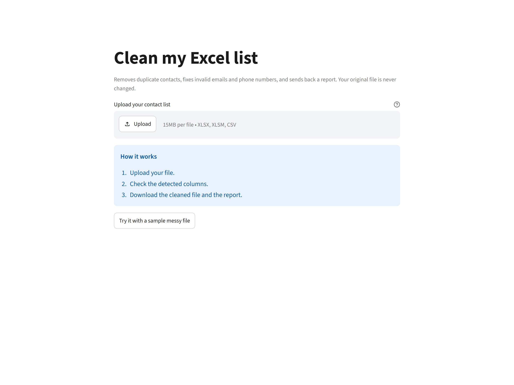
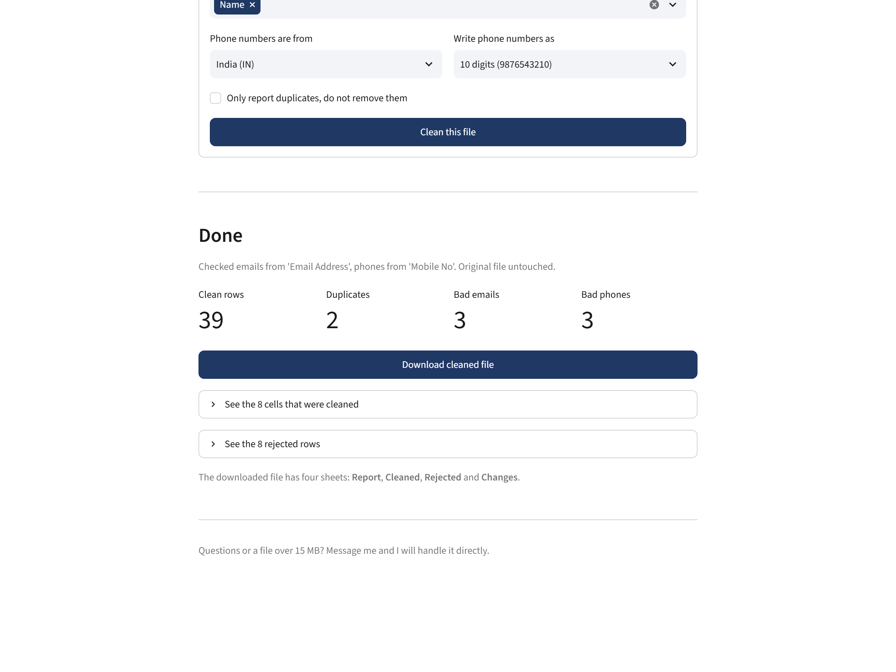

# Excel Cleanup Tool


Turns a messy Excel or CSV contact list into a clean, import-ready file — and
shows the client exactly what it changed and what it threw away.

Built for the job most small businesses actually have: a spreadsheet of leads or
customers where the same person appears three times, half the emails are broken,
phone numbers are typed five different ways, and there are blank rows scattered
throughout.

## What it does

| | |
|---|---|
| **Reads** | `.xlsx`, `.xlsm`, `.csv` (comma, semicolon, tab or pipe separated) |
| **Cleans** | trims spaces, removes invisible characters, normalises case and phone formats |
| **Validates** | email syntax, phone numbers against a country's numbering rules |
| **De-duplicates** | same email *or* same phone number, keeping the first occurrence |
| **Reports** | a styled workbook with a summary, the cleaned rows, and every rejected row with its reason |

The original file is never modified.

## What it looks like

The client opens a link, drags a file in, and gets the cleaned workbook back.



After clicking *Clean this file*, they see exactly what changed before they
download anything:



## Two ways to use it

**Web app** — the client uploads a file in the browser and downloads the cleaned
one. Nothing to install on their computer.

**Command line** — for your own batches, scripting, or running inside another
tool.

## Web app

```bash
pip install -r requirements.txt
streamlit run app.py
```

Opens at `http://localhost:8501`. Or double-click `run_web.bat`, which sets up a
private environment in `%LOCALAPPDATA%\excel-automation-venv` on first use and
starts the server — no terminal needed.

What the page does:

- reads the uploaded file and **detects the email and phone columns** by content
- shows the first rows so the client can confirm it is the right file
- lets them override the columns, the country, and the phone format
- shows the counts (clean rows, duplicates, bad emails, bad phones) and the
  rejected rows **before** they download anything
- hands back the same four-sheet workbook as the command line

Guards: 15 MB limit, `.xlsx` / `.xlsm` / `.csv` only, and every error is shown as
a plain sentence rather than a stack trace.

Deploy it free on [Streamlit Community Cloud](https://share.streamlit.io) by
pointing it at this repo and `app.py`; `requirements.txt` already includes
Streamlit.

## Quick start (command line)

```bash
pip install -r requirements.txt
python -m src.main --input data/sample_dirty.xlsx --out output/clean.xlsx
```

No column names needed — the tool finds the email and phone columns by looking
at what is in the cells:

```
  Excel cleanup finished
  --------------------------------------------
  columns detected automatically:
    email  'Email Address'
    phone  'Mobile No'
  rows read              49
  rows kept              39
  rows rejected           8
    duplicates            2
    invalid email         3
    invalid phone         3
  blank rows gone         2
  --------------------------------------------
  written to       output\clean.xlsx
```

### For someone who does not use a terminal

`run.bat` handles everything: it checks for Python, installs the packages on
first use, cleans the file, and opens the result.

- Drag an Excel/CSV file onto `run.bat`, or
- run `run.bat "C:\path\to\contacts.xlsx"`, or
- run `run.bat "C:\path\to\contacts.xlsx" "Email Address" "Mobile No"`

Output lands next to the input file in an `output` folder.

## The output workbook

Four sheets, report first, because that is what the client actually looks at.

**Report** — one screen answering "what did you do to my file?":

- rows read / kept / rejected
- duplicates removed, invalid emails, invalid phones, missing required fields
- blank rows dropped, and blank contacts that were allowed through
- a breakdown of *why* rows were rejected
- the rules that were applied, so the numbers are reproducible

**Cleaned** — rows that passed every check, with emails lowercased and phone
numbers normalised. Header frozen, filters on, column widths fitted.

**Rejected** — nothing is deleted silently. Every dropped row is here with its
original row number and a reason such as:

```
7   duplicate of row 2 (same phone 9876543210)
9   invalid email: 'karan.mehta@gmail'
12  invalid phone: '12345'
```

This sheet is the difference between "a script" and "a service": the client can
audit the result and trusts it, which is what earns repeat work.

**Changes** — every cell that was actually altered, before and after:

```
Row #  Column        Before                  After             Fix
3      Email Address Priya.Patel@Yahoo.com   priya.patel@yahoo.com  email
3      Mobile No     +91 98765 43211         9876543211        phone
4      Mobile No     09876543212             9876543212        phone
6      Name            Vikram Singh           Vikram Singh      spacing
```

This is the sheet that justifies a monthly fee. The Rejected sheet says what was
thrown away; this one says what was *fixed*, cell by cell. "59 rows, 8 cells
cleaned" is a receipt. "I cleaned your file" is a claim.

The list is capped at the first 20,000 changed cells so a huge file cannot
produce an unusable workbook; the Report sheet says so when the cap is hit.

## What counts as a duplicate

Two rows are duplicates if their **normalised email matches**, or their
**normalised phone matches** — whichever hits first. Values are normalised
before comparing, so all of these collapse into one:

```
Rahul Sharma   rahul.sharma@gmail.com    9876543210
Rahul S        RAHUL.SHARMA@GMAIL.COM    +91 98765 43210
Rahul          rahul.sharma@gmail.com    09876543210
```

Rows with no email *and* no phone fall back to a full-row comparison. The first
occurrence wins; the rest are listed in `Rejected` with the row number of the
row they duplicate.

If a client would rather keep everything and just see what collided, pass
`--keep-duplicates`.

## Choosing columns

The tool guesses by reading the cells, which works on most files. When it
guesses wrong, or you want to be explicit:

```bash
python -m src.main \
  --input raw.xlsx \
  --email-col "Email Address" \
  --phone-col "Mobile No" \
  --name-col "Customer Name" \
  --required "Name,Email Address" \
  --out output/clean.xlsx
```

Column names are matched ignoring case and spacing, so `Email Address`,
`EMAIL ADDRESS` and `email  address` all work.

`--required` is the strictness dial: any listed column must be present and
non-empty, or the row is rejected. Without it, a blank email or phone is allowed
through — it is reported under "blank emails (allowed)" rather than deleted.

### Config files

For repeat work, save the mapping and reuse it. `config/sample.json` is a
working example:

```json
{
  "email_col": "Email Address",
  "phone_col": "Mobile No",
  "name_col": "Name",
  "required": ["Name"],
  "country": "IN",
  "phone_format": "local",
  "header_row": 1
}
```

```bash
python -m src.main --input raw.xlsx --config config/sample.json --out output/clean.xlsx
```

Anything passed on the command line overrides the config file, so one config can
serve several clients.

## Validation rules

**Email** — must have exactly one `@`, a domain, and a real TLD. Rejected:
`karan.mehta@gmail`, `divya@@gmail.com`, `arjun.rao@`, `.john@gmail.com`,
`john..doe@gmail.com`. Lowercased and trimmed. No network lookups, so it never
issues DNS queries and works offline. A space in the middle (`john doe@gmail.com`)
is treated as an error rather than silently rewritten, because guessing could
send mail to the wrong person.

**Phone** — stripped to digits, then checked against the numbering plan:

| Rule | Handles |
|---|---|
| `IN` | `9876543210`, `+91 98765 43210`, `09876543210`, `919876543210`, `98765-43210` |
| `US` | `(415) 555-2671`, `+1 415 555 2671` |
| `ANY` | any 6–15 digit number, digits only |

Indian mobiles must start with 6–9. `--phone-format local` writes 10 digits,
`e164` writes `+919876543210`, `digits` writes the bare number.

## All options

| Option | Default | Meaning |
|---|---|---|
| `--input` | — | source `.xlsx` / `.xlsm` / `.csv` |
| `--out` | — | destination `.xlsx` (required) |
| `--sheet` | first sheet | sheet name or 0-based index |
| `--header-row` | `1` | row holding the headers |
| `--email-col` | auto | email column header |
| `--phone-col` | auto | phone column header |
| `--name-col` | auto | name column header |
| `--required` | none | comma-separated must-not-be-empty columns |
| `--country` | `IN` | `IN`, `US` or `ANY` |
| `--phone-format` | `local` | `local`, `e164` or `digits` |
| `--config` | none | JSON file with any of the above |
| `--keep-duplicates` | off | report duplicates but keep them |
| `--keep-blank-rows` | off | keep rows where every cell is empty |
| `--list-sheets` | — | print sheet names and exit |
| `--quiet` | off | only print errors |

Exit codes: `0` success (rejected rows are normal), `2` bad input or configuration.

## Development

```bash
pip install -r requirements-dev.txt
python -m pytest
python scripts/make_sample.py    # regenerate data/sample_dirty.xlsx
```

103 tests cover the validators, the cleaning rules, column detection, the web
app's processing path, and the full file-in/file-out flow. The three app smoke
tests skip automatically if Streamlit is not installed.

```
app.py             Streamlit front end (widgets and wording only)
run_web.bat        starts the web app, creates its environment on first run
src/
  main.py          CLI, argument handling, summary output
  webapp_core.py   web app logic, testable without Streamlit
  config.py        Config dataclass + validation
  reader.py        xlsx/csv loading, column detection, encoding fallback
  validators.py    email and phone normalisation
  cleaner.py       per-row checks, de-duplication, rejection reasons
  report.py        styled four-sheet workbook
scripts/
  make_sample.py   generates the deliberately messy demo file
tests/
  test_validators.py, test_cleaner.py, test_reader.py,
  test_webapp_core.py, test_end_to_end.py, test_app_smoke.py
```

## Troubleshooting

**"cannot write ... Is that file open in Excel?"** Close it and rerun. Windows
locks open workbooks.

**Phone numbers show as `9.87654E+09`.** The input cells are numeric, not text.
Everything is read as text, so this only happens in the client's original file;
they should format the column as Text before pasting.

**A column was not detected.** Run with `--email-col "Exact Header"`. The error
message lists the columns it can see.

**CSV looks garbled.** Encoding is auto-detected (UTF-8, UTF-8-BOM, Windows-1252,
Latin-1). If a file is still wrong, re-save it as UTF-8 CSV.

**Large files.** A 100,000-row file takes roughly 20 seconds on a normal laptop.
Reading and writing are streamed by openpyxl, so memory stays modest.

**Streamlit will not install next to Google AI packages.** Streamlit needs
`protobuf>=5.26`, while some `google-generativeai` setups pin protobuf below 5.
Those cannot share one environment. Use `run_web.bat`, which keeps the web app's
packages in `%LOCALAPPDATA%\excel-automation-venv` and leaves your main Python
untouched.

**`run_web.bat` cannot create the environment.** This project folder is nested
deeply enough that Windows hits its 260-character path limit. The launcher puts
the environment in `%LOCALAPPDATA%` to avoid that; if you still see it, move the
project to a shorter path such as `C:\Projects\excel-automation`.

## Licence

MIT — use it commercially, sell the service, adapt it per client.
